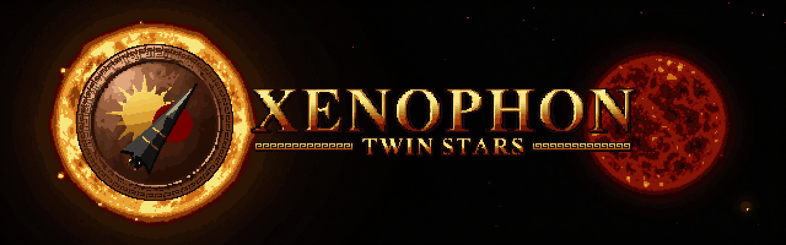
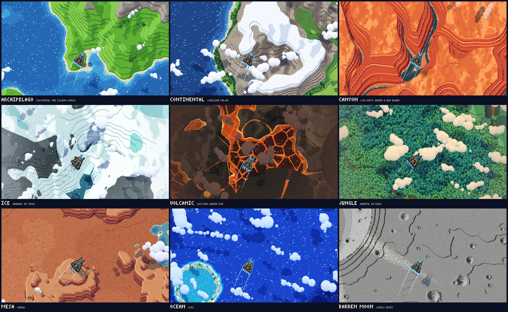
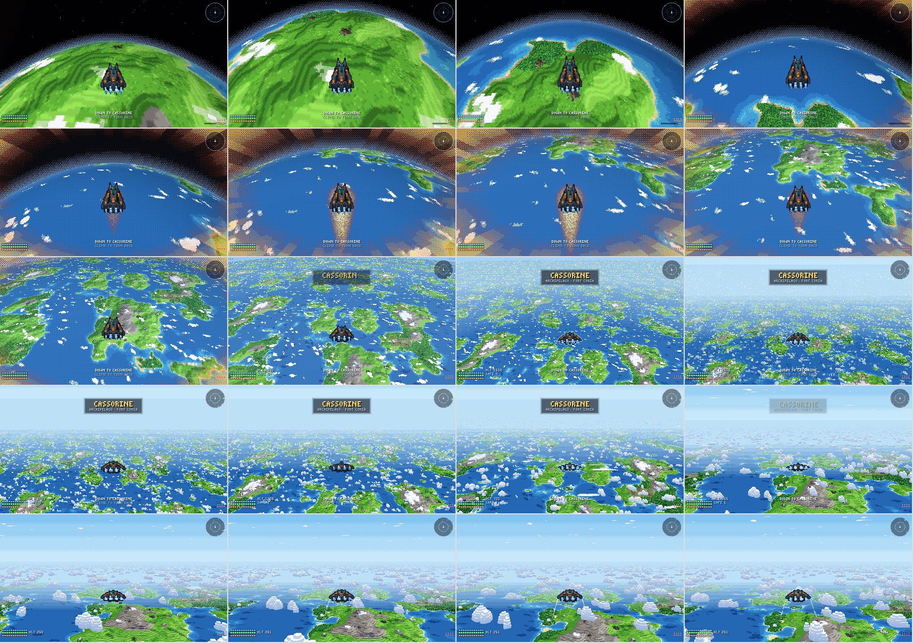
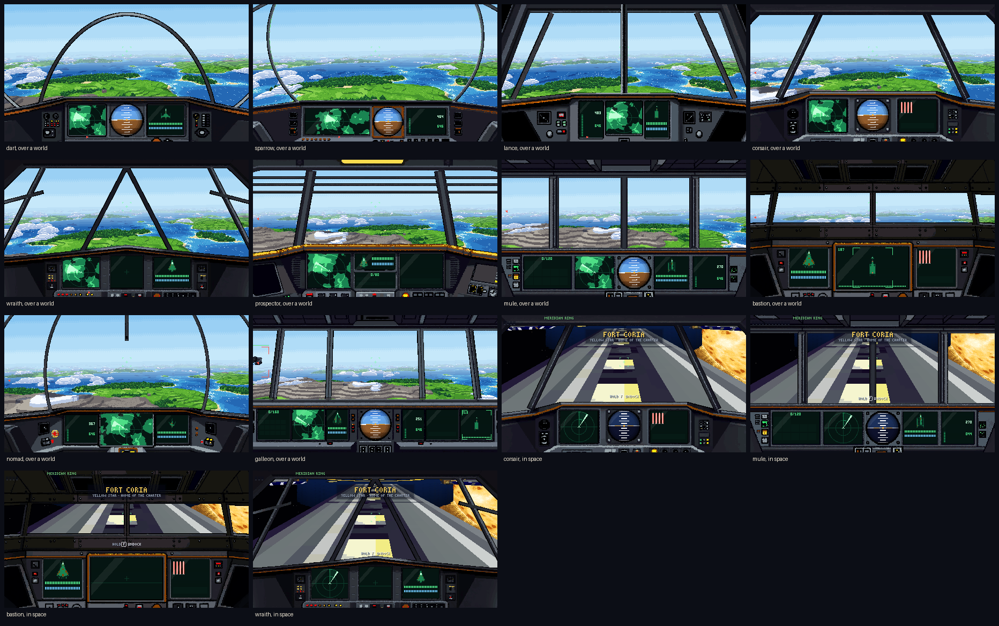
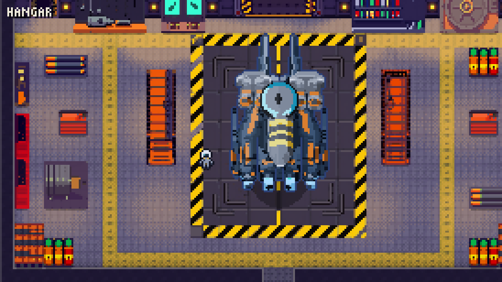
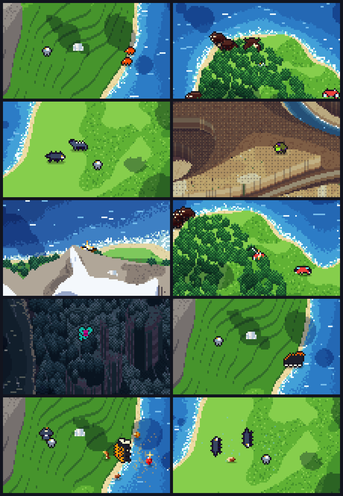
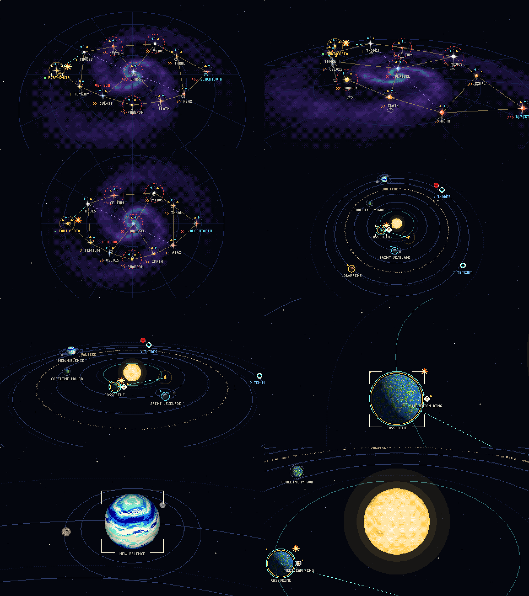

<p align="center">
  
</p>

<p align="center">
  <b>A multiplayer pixel-art space game that runs in a browser tab, with no server.</b><br />
  Forty worlds between a gold sun and a red one. Two sides at war over every one of them.
</p>

<p align="center">
  <a href="https://xenophon.me"><b>Play it at xenophon.me</b></a> ·
  <a href="CONTRIBUTING.md">Contribute</a> ·
  <a href="docs/implementation-plan.md">The design</a> ·
  <a href="docs/factions-and-races.md">The lore</a>
</p>

<p align="center">
  <a href="https://github.com/strickland84/xenophon/actions/workflows/ci.yml"></a>
  <a href="LICENSE"></a>
  <a href="ASSETS.md"></a>
</p>

---

## The war

<p align="center"><i>It is a time of war.</i></p>

<p align="center">
Between a gold sun and a red one lie forty worlds. Long ago they were shared out by lottery, and the
<b>NOMARCHY</b>, rulers of the gold sun, have kept the register of who owns what ever since.
</p>

<p align="center">
The <b>ANARCHOI</b>, the families who drew no world, have never accepted it. They say a world belongs to whoever
plants a flag on it, and they have been planting flags for three generations.
</p>

<p align="center">
Fighting has broken out again over <b>DRASSEL</b>, the system at the heart of the forty worlds. Raiders loyal to
neither side prey on the cargo ships caught between them. Both sides are short of pilots, and will give a ship to
anyone who signs up.
</p>

<p align="center">
At a dock on the edge of the war, a new pilot sits in a cold ship, waiting for clearance to launch...
</p>

## What the game stands for

1. **No server, ever.** The game is a folder of static files. Players meet peer to peer, and the shared galaxy lives
   on public Nostr relays. There are no accounts, no backend and nothing for anyone to switch off. A change that
   needs a server of ours will not be merged.
2. **Fun first.** A feature is done when it is fun to play, not when it works.
3. **Beautiful pixel art.** Every pixel on screen is the same size, sprites are never scaled, and programmer art
   never ships.
4. **Fair.** Nothing is sold. Ranks, paint and furniture never add power, and no hull or fit is more than a little
   better than another.
5. **For everyone.** It runs alone and offline, on a phone held sideways, with a keyboard, a controller or a touch
   screen.
6. **Open.** The code is GPL-3.0, and anyone can read it, change it and help make the game.

## Help wanted

These are the four areas where the game most needs help:

- **Art:** ships, places, creatures, the interface, effects. The pipeline draws with local image models and turns the
  pictures into pixel art by code. Mockups, references and critique help as well.
- **Music and sound:** the score, sound effects, the mix, and creatures' own voices.
- **Gameplay:** the feel of flying and fighting, the loop of mining and banking, the balance, and new things to do.
- **A bigger galaxy:** new worlds and kinds of world, new star systems, stations, settlements with something to do in
  them, creatures, and events.

Read [CONTRIBUTING.md](CONTRIBUTING.md), then open an issue or a pull request.

## The game

<table>
  <tr>
    <td width="50%"></td>
    <td width="50%"></td>
  </tr>
  <tr>
    <td><b>Forty worlds, made by code.</b> Archipelagos, ice, canyons, volcanoes, jungles and ocean, each 16,000 pixels
    round, with its own weather, day and night, ore, settlements and ruins.</td>
    <td><b>One seamless universe.</b> Climb out of a world's air into its star system, cruise past suns, gas giants,
    belts and black holes, jump the gates, and dive down to any world. No loading screens.</td>
  </tr>
  <tr>
    <td></td>
    <td></td>
  </tr>
  <tr>
    <td><b>Fly from above, behind or the seat.</b> Ten angular hulls carved as voxel solids, every one with its own
    cockpit. Dogfight other pilots and raiders, mine ore, and carry it home: shot down, your hold spills for anyone.</td>
    <td><b>Your ship is yours.</b> Buy hulls, fit guns and modules that show on the hull, paint every colour, then
    get out of the seat and walk its rooms, your hangar and the station deck.</td>
  </tr>
  <tr>
    <td></td>
    <td></td>
  </tr>
  <tr>
    <td><b>On foot, too.</b> Climb out anywhere, hunt creatures for hide and heartstone, plant flags, steal a parked
    ship, or come down by parachute behind enemy lines and walk home.</td>
    <td><b>A galaxy that remembers.</b> Flags, wrecks, graves, beacons and the names of worlds outlast the session.
    Who holds what is worked out by every player's game from signed events on public Nostr relays.</td>
  </tr>
</table>

## How it works

Everything runs in the browser. The site is plain static files; there is no server of ours.

- **The engine** (`src/lib/engine/`) is a small software renderer and a deterministic simulation in TypeScript, with
  no DOM: it is stepped with a time and the player's controls, and gives back a picture as bytes. Every pixel lands
  in one low-resolution buffer, so nothing is ever scaled.
- **Multiplayer** is peer to peer: players find each other through public Nostr relays and then talk directly,
  browser to browser, over WebRTC ([Trystero](https://github.com/dmotz/trystero)). Shots are decided by the
  shooter's game, missiles by the target's.
- **The persistent galaxy** is a set of signed Nostr events. Every game works out territory from them with one pure
  rule, so the map agrees without anyone in charge.
- **The art** is drawn by local image models from grey shape guides and turned into true pixel art by code: ships are
  carved into voxels from three views ([docs/pixel-art-techniques.md](docs/pixel-art-techniques.md)).
- **The tests** fly scripted flights and pin every frame's pixels, so a change that alters the picture by accident is
  caught.

Built with SvelteKit (Svelte 5) and TypeScript. Phones held sideways are first class: every control has a touch
version.

## Running it

You need Node 24.

```sh
npm ci
npm run dev        # http://localhost:5173
npm test           # the tests, including every pinned frame (about 40 seconds)
npm run build      # plain static files in build/
```

`?net=off` keeps a tab off the network; everything works alone. The developer's guide, with every tool and script,
is [docs/developing.md](docs/developing.md).

## Licence

The code is free software under the [GNU GPL, version 3](LICENSE). The art, music, sounds, narrator's voice, logo
and name are not: they are all rights reserved, and may be used to run, play and develop this game
([ASSETS.md](ASSETS.md)).
